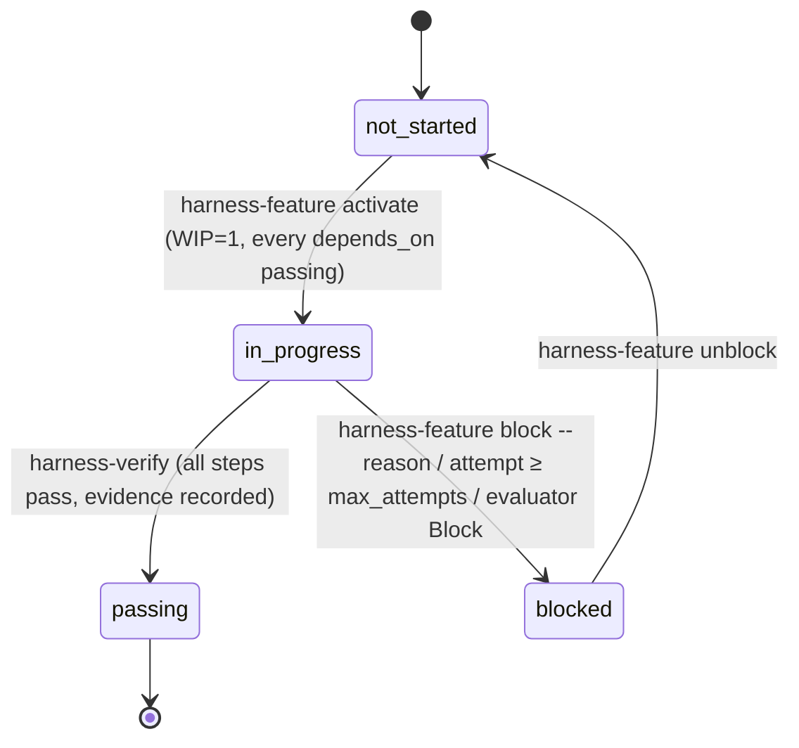

# How the Ideaforge harness works

The harness is the set of files, scripts and hooks that let a coding agent build this repository
one feature at a time without drifting, and let a driver run those sessions unattended. It is a
port of the Metsävahti harness (reference tag `harness-reference`), which follows the course
[learn-harness-engineering](https://github.com/walkinglabs/learn-harness-engineering) (lectures 1–13)
and Anthropic's harness articles. The decisions behind it are D-001–D-006 in
[../DECISIONS.md](../DECISIONS.md).

The harness is **development tooling**. It builds Ideaforge; it never runs the pipeline. A
`/validate` run is a pipeline session (CLAUDE.md → Pipeline sessions) and has its own hooks.

## 1. The parts

| Part                 | Files                                                                                                                                                                                  | Role                                                                                                                                                                                                          |
| -------------------- | -------------------------------------------------------------------------------------------------------------------------------------------------------------------------------------- | ------------------------------------------------------------------------------------------------------------------------------------------------------------------------------------------------------------- |
| Instructions         | [AGENTS.md](../../AGENTS.md), [CLAUDE.md](../../CLAUDE.md)                                                                                                                             | The operating manual every development session reads: clock-in, verification layer, constraints with `why:`, definition of done, clock-out. CLAUDE.md adds Claude Code wiring and the pipeline-session rules. |
| State                | [feature_list.json](../../feature_list.json), [PROGRESS.md](../../PROGRESS.md), [DECISIONS.md](../DECISIONS.md)                                                                        | The queue (one entry per ticket, `depends_on`, `verification[]`, `evidence[]`), the session log, the decisions. The repository, not the chat, remembers.                                                      |
| Spec                 | [../../IMPLEMENTATION_PLAN.md](../../IMPLEMENTATION_PLAN.md), [../TICKETS.md](../TICKETS.md) (tickets + "Plan notes and deviations")                                                   | What to build. A feature's `spec` field points at its ticket heading; the ticket cites plan sections.                                                                                                         |
| Verification         | `pnpm check` (L1)                                                                                                                                                                      | One named layer: typecheck, Prettier, the harness unit tests and the full pytest suite. A feature lists the exact commands it needs. `manual:` steps are human-only.                                          |
| Scripts              | `scripts/validate-feature-list.ts`, `harness-feature.ts`, `verify-feature.ts`, `clean-state-check.sh`, `harness-loop.ts`, `harness-events.ts`                                          | Every state transition and every gate is a script with an exit code (`pnpm harness:*`). Skills and the driver call them; nobody edits `feature_list.json` by hand.                                            |
| Claude Code wiring   | `.claude/settings.json`, `.claude/hooks/*`, `.claude/skills/{clock-in,verify-feature,clock-out}`, `agent_templates/evaluator.md.j2` → `.claude/agents/evaluator.md`                    | Permissions, hooks (SessionStart summary, PreToolUse `guard.sh`, PostToolUse Prettier, opt-in Stop guard), skills, the evaluator subagent. The pipeline hooks (`ideaforge.*`) run alongside.                  |
| Driver               | `scripts/harness-loop.ts`, [harness.config.json](../../harness.config.json), [prompts/](prompts/)                                                                                      | Runs the loop unattended: worktree per feature, generator session, deterministic post-check, evaluator session, PR.                                                                                           |
| Observability        | `.harness/traces/*`, `.harness/runs.jsonl` (gitignored), PR bodies, `PROGRESS.md`                                                                                                      | Full `stream-json` trace of every session, a readable log, one line per run.                                                                                                                                  |
| Templates and rubric | [clean-state-checklist.md](clean-state-checklist.md), [evaluator-rubric.md](evaluator-rubric.md), [session-handoff.md](session-handoff.md), [quality-document.md](quality-document.md) | The judgement half of the checklists, the scoring rubric (machine-output contract and tuning log), handoff notes, quality grades.                                                                             |

## 2. One feature, two ways to run it

### Interactive (a human starts the session)

```
/clock-in F-014          pnpm harness:feature next → show → activate      (WIP=1, deps passing)
   implement             read the ticket + plan sections, obey AGENTS.md constraints
/verify-feature F-014    pnpm harness:verify F-014   → L1 steps in order → evidence → passing
/clock-out               scripts/clean-state-check.sh + judgement checklist → PROGRESS.md → commit
```

Human-only features (a `manual:` step: live API recording, a real `/validate` run, a decision only
the user can make) always run this way. After doing the manual step, run
`pnpm harness:verify F-NNN --manual-observed "<what you saw>"`.

### Driver-run (`pnpm harness:loop`)

```mermaid
sequenceDiagram
    participant D as Driver (harness-loop.ts)
    participant G as Generator session (claude -p)
    participant S as Scripts (harness-feature / verify / clean-state)
    participant E as Evaluator session (claude -p + evaluator.md as system prompt)
    participant GH as GitHub (gh)

    D->>D: preflight: main clean & in sync, harness:check, gh, claude + one probe request per configured model
    D->>S: harness-feature next (skip human-only and in-flight features)
    S-->>D: F-014
    D->>D: git worktree add ../idea-generator-worktrees/F-014 -b feat/F-014 main; FAST=1 ./init.sh
    D->>G: prompt (prompts/generator.md), env HARNESS_LOOP=1 HARNESS_STOP_GUARD=1, caps
    G->>S: /clock-in → activate; implement; /verify-feature → harness:verify; clock-out → clean-state, commit
    Note over G: Stop hook blocks stopping until clean-state passes (max 3×)
    G-->>D: result line: turns, cost, denials
    D->>S: post-check in the worktree: status passing|blocked, clean-state --require-terminal, commits ahead
    alt post-check fails
        D->>S: harness-feature attempt (auto-blocks at max_attempts) → retry once with the failure appended
    end
    D->>E: evaluate F-014 (rubric, JSON schema), fresh context, read-only
    E-->>D: verdict Accept | Revise | Block + scores + findings
    alt Revise
        D->>G: retry once with the findings appended
    else Block
        D->>S: harness-feature block; push branch; notify
    else Accept
        D->>GH: git push; gh pr create (evidence, verdict, cost, trace path)
        D->>GH: wait for merge (merge: "auto" arms gh pr merge --auto --squash)
        D->>D: git worktree remove; git pull main; next feature
    end
```

`HARNESS_LOOP=1` also tells the pipeline guard (`ideaforge.guard`) that this is a development
session, so the worktree needs no `.ideaforge-dev` marker (D-005). Subagents stay strict.

### Feature state machine



`attempts` counts driver-run sessions; `max_attempts` (feature field or `caps.maxAttempts`) auto-blocks.
`ready` = `not_started` with every dependency `passing`; the driver additionally skips features with a
`manual:` step (human-only) and features whose branch already exists on `origin` (in flight).

## 3. What each safeguard catches

| Safeguard                                           | Catches                                                                                                                                                                                                                             | Where                                                       |
| --------------------------------------------------- | ----------------------------------------------------------------------------------------------------------------------------------------------------------------------------------------------------------------------------------- | ----------------------------------------------------------- |
| Permission allow rules (`--allowedTools`, settings) | The known-good pnpm/uv/git path runs without prompts or classifier round-trips                                                                                                                                                      | `harness.config.json`, `.claude/settings.json`              |
| Auto-mode classifier                                | Anything not on the allowlist is reviewed by a second model; `--permission-prompts none` denies what would have prompted                                                                                                            | Claude Code                                                 |
| Deny rules                                          | `.env`, generated agent files, both lockfiles, `curl`/`wget`, force push, `reset --hard`, in every mode                                                                                                                             | `.claude/settings.json`                                     |
| `guard.sh` (PreToolUse)                             | Bare `python`/`pytest`/`pip`, `pip install`, npm/yarn/npx, destructive git, `rm -rf`; invalid `feature_list.json` before a commit; in loop mode also `git push`, `checkout main`, worktree commands and writes outside the worktree | `.claude/hooks/guard.sh`                                    |
| `ideaforge.guard` (PreToolUse, pipeline)            | Pipeline writes outside `runs/`/`cache/`, research agents writing anything but their own file, network fetches in shell                                                                                                             | `src/ideaforge/guard.py`                                    |
| `harness:check` (validator)                         | Two `in_progress`, `passing` without evidence, unknown or cyclic `depends_on`, `in_progress` with unmet deps                                                                                                                        | runs from unit tests, lint-staged, the guard and the driver |
| `harness:verify`                                    | A step skipped or run out of order; `manual:` steps waived unattended                                                                                                                                                               | the only way a feature becomes `passing`                    |
| `clean-state-check.sh`                              | Dirty tree, added skips/xfails, lowered coverage thresholds, debugger calls, missing PROGRESS.md update, staged `.env`, broken `init.sh`                                                                                            | clock-out, Stop hook, driver post-check                     |
| Stop hook (`stop-guard.sh`, loop only)              | A session ending with an unverified or uncommitted feature (max 3 blocks, respects `stop_hook_active`)                                                                                                                              | `.claude/hooks/stop-guard.sh`                               |
| Driver post-check                                   | A transcript that claims success while the branch says otherwise (status, clean-state, no commits)                                                                                                                                  | `scripts/harness-loop.ts`                                   |
| Evaluator (fresh context, read-only)                | Work that passes its own tests but misses the behaviour, scope creep, stale evidence, bad handoff                                                                                                                                   | `agent_templates/evaluator.md.j2`, `evaluator-rubric.md`    |
| Caps                                                | Runaway sessions: turns, budget, wall clock, attempts, consecutive failures                                                                                                                                                         | `harness.config.json`                                       |
| CI on the PR                                        | `pnpm check` again on a clean runner (job `L1 (pnpm check)`)                                                                                                                                                                        | `.github/workflows/ci.yml`                                  |

## 4. Operating the loop

**Prerequisites (once):**

- `uv`, `claude` and `gh` on the Git Bash `PATH`. On Windows they live in `%USERPROFILE%\.local\bin`
  and `C:\Program Files\GitHub CLI`; add both to the user `Path` and open a new terminal. Without
  `uv` the pipeline hooks fail open and `./init.sh` stops.
- `gh auth login` (HTTPS is enough; the token needs `repo` and `workflow`).
- `main` clean and in sync with `origin/main`.
- GitHub: auto-merge and squash merging allowed, and `main` protected with the required check
  `L1 (pnpm check)`. Only then set `merge` in `harness.config.json` from `"wait"` to `"auto"`;
  without protection `gh pr merge --auto` merges before CI runs.
- Run `claude` interactively in the repository once and accept the trust dialog; until then Claude
  Code ignores `permissions.allow` in `.claude/settings.json` and sessions rely on `allowedTools`
  from `harness.config.json` alone.
- Run the driver from Git Bash. It runs `pnpm` through node there, because the `pnpm.cmd` shim
  cannot be spawned without a shell. Desktop notifications are macOS-only; on Windows watch the console.

**Commands**

| Command                             | What it does                                                                                              |
| ----------------------------------- | --------------------------------------------------------------------------------------------------------- |
| `pnpm harness:loop --dry-run`       | Prints the worktree commands and the exact `claude` invocations for the next ready feature; runs nothing. |
| `pnpm harness:loop --once`          | One feature end to end, then stops. Use this for the first runs.                                          |
| `pnpm harness:loop --feature F-014` | This feature only (it must be ready and unattended-capable).                                              |
| `pnpm harness:loop`                 | Loop until nothing is ready, a stop condition hits, or Ctrl-C (finishes the current session first).       |
| `--auto-merge`                      | `gh pr merge --auto --squash --delete-branch` for this run.                                               |
| `--no-wait`                         | Do not wait for the merge; continue with features that do not depend on the open PR.                      |
| `pnpm harness:report`               | Table of past runs from `.harness/runs.jsonl` (feature, attempt, outcome, verdict, turns, cost, PR).      |
| `pnpm harness:feature list`         | Queue overview with `[ready]` / `[ready, human-only]` markers.                                            |

**Reading a run.** The console and `.harness/traces/F-NNN-<timestamp>.log` show the same readable
log (`scripts/harness-events.ts`): every tool call with its target, milestones (activate, verify,
`pnpm check`, the clean-state check, commits) with `✓`/`⚠`/`✗`, `⛔` lines for hook blocks and
denials, a heartbeat every 5 minutes, the post-check, the evaluator's scores and findings, each CI
check and the merge. `.harness/traces/F-NNN-<timestamp>.generator.jsonl` is the full stream; its
`result` line carries `num_turns`, `total_cost_usd` and `permission_denials`.

**Intervening.** Merge or close the PR (a closed PR stops the loop for that feature); unblock a
feature with `pnpm harness:feature unblock F-NNN` after fixing the cause; edit the ticket in
`docs/TICKETS.md` (and the feature's entry through the scripts); lower or raise the caps in
`harness.config.json`; add an allow rule when `permission_denials` shows the same legitimate
command denied twice. After each of the first 3–5 runs, compare the evaluator's scores with your
own and record the rubric change in its tuning log.

**Cost expectations.** The caps start at the porting guide's values (200 turns, 15 USD, 60 minutes
per generator session; evaluator 60 turns, 4 USD). In Metsävahti a unit-test-only feature took
20–60 turns and a few dollars, and about a third of each session went on clock-in overhead, which
is why the tickets here are merged into fewer, session-sized features. Raise the caps only after
measuring (`pnpm harness:report`).

## 5. Limits

- **Sequential only.** Every PR touches `feature_list.json` and `PROGRESS.md`; the driver waits for
  each merge before a dependent feature starts.
- **Human-only features.** Anything with a `manual:` step stays interactive:
  - recording live API fixtures
  - a real `/validate` or `/debate` run
  - the golden set
  - the §13 decisions

  `harness:verify --allow-manual` / `--manual-observed` is for a person who did the step.

- **Offline sessions.** Unattended sessions never fetch live data; tests run on committed fixtures.
- **Not a sandbox.** Sessions run on the host with the classifier, the deny list and both guards
  as the boundary; `bypassPermissions` is deliberately not used (D-002).
- **Workspace trust.** See the prerequisites above.

Copying the harness from the reference: `git -C <metsavahti> show harness-reference:docs/harness/porting-guide.md`.
